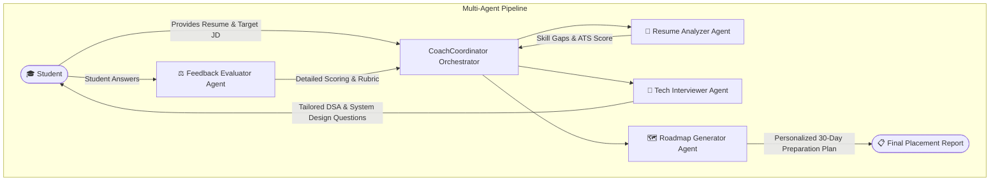

# 🎓 Agentic Campus Placement Coach

[](https://www.python.org/)
[]()
[]()
[](LICENSE)

An intelligent, autonomous **Multi-Agent Career Counseling and Interview Simulation System** engineered specifically for 3rd and 4th-year Computer Science Engineering students preparing for on-campus and off-campus placements.

---

## 📌 Problem Statement

Engineering students aiming for software engineering roles face significant challenges:
1. **Resume Blindspots**: Resumes often lack ATS (Applicant Tracking System) keywords, quantifiable metrics, or match the exact Job Description (JD).
2. **Generic Practice**: Standard online interview platforms offer generic questions rather than targeting a student's personal weaknesses or project stack.
3. **Absence of Actionable Feedback**: Mock interviews rarely produce structured, topic-specific improvement roadmaps.

**Agentic Campus Placement Coach** solves this using a collaborative multi-agent architecture where specialized agents evaluate, question, critique, and guide the candidate.

---

## 🧠 System Architecture

The system employs a **hierarchical coordinator-worker multi-agent pattern**:



---

## 🤖 Specialized Agent Roles

| Agent | Responsibility | Key Input | Key Output |
| :--- | :--- | :--- | :--- |
| **`ResumeAnalyzerAgent`** | Semantic keyword matching, ATS scoring, stack verification | Student Resume, Target JD | ATS Score (0-100), Missing keywords, Skill strengths |
| **`TechInterviewerAgent`** | Generates dynamic technical/behavioral questions targeting candidate's claimed skills & weak spots | Resume gaps, Role level | Tailored DSA & System Design prompts |
| **`FeedbackEvaluatorAgent`** | Evaluates candidate answer depth, complexity awareness, and edge-case handling | Student Answer, Reference Criteria | Conceptual score, Rubric breakdown, Corrections |
| **`RoadmapGeneratorAgent`** | Formulates structured daily/weekly study milestones | Overall evaluation gaps | 30-Day sprint study guide with curated topics |
| **`CoachCoordinator`** | Orchestrates agent communication state & synthesis | End-to-end telemetry | Final Markdown Audit & Study Dossier |

---

## 📂 Repository Structure

```text
Agentic-Campus-Placement-Coach/
├── README.md                  # Comprehensive project documentation & viva guide
├── requirements.txt           # Minimal dependencies
├── .gitignore                 # Standard Python exclusions
├── demo.py                    # Zero-dependency interactive placement demo
├── main.py                    # CLI entrypoint with customizable parameters
├── data/
│   ├── sample_resume.txt      # Demo 3rd-year student resume
│   └── sample_jd.txt          # Sample SDE-1 graduate job description
└── src/
    ├── __init__.py
    ├── orchestrator.py        # Central multi-agent coordinator
    └── agents/
        ├── __init__.py
        ├── resume_analyzer.py
        ├── mock_interviewer.py
        ├── feedback_evaluator.py
        └── roadmap_generator.py
```

---

## ⚡ Quickstart & Setup

### 1. Prerequisites
- Python 3.8 or higher.
- No heavy GPU or API keys required to test the core agentic reasoning engine! (Optional OpenAI/Gemini support included).

### 2. Clone the Repository
```bash
git clone https://github.com/ROOPESH23-GIT/Agentic-Campus-Placement-Coach.git
cd Agentic-Campus-Placement-Coach
```

### 3. Run the Out-of-the-Box Demo
The demo runs an automated end-to-end simulation of a candidate preparing for a Software Development Engineer (SDE-1) placement drive:

```bash
python demo.py
```

### 4. Run with Custom Files
```bash
python main.py --resume data/sample_resume.txt --jd data/sample_jd.txt
```

---

## 🖥️ Sample Run Output

```text
============================================================
🎓 AGENTIC CAMPUS PLACEMENT COACH - SYSTEM ACTIVATED
============================================================
[Agent: ResumeAnalyzer] Analyzing student profile against SDE-1 JD...
  ✓ ATS Match Score: 78%
  ✓ Identified Strengths: Python, REST APIs, React, SQLite
  ⚠ Flagged Missing Competencies: Redis, Docker, System Design Fundamentals

[Agent: TechInterviewer] Formulating targeted interview round...
  Q1 [DSA - Medium]: "Explain how you would design an LRU Cache in O(1) time complexity."
  Candidate Answer: "I would use a Hash Map combined with a Doubly Linked List."

[Agent: FeedbackEvaluator] Grading response...
  ✓ Accuracy Score: 9/10
  ✓ Feedback: Correct data structure choice. Good explanation of pointer updates.

[Agent: RoadmapGenerator] Synthesizing 30-Day Targeted Action Plan...
  Week 1: Caching primitives, Redis, Hash Map internals.
  Week 2: Docker containers, microservice basics.
  Week 3: Concurrency & database indexing.
  Week 4: Full mock interviews & behavioral STAR method.
============================================================
✨ Assessment complete! Report generated at output/placement_audit.md
============================================================
```

---

## 💡 Key CSE Academic Concepts Demonstrated

1. **Autonomous Agents**: Autonomous decision making based on observation $\rightarrow$ analysis $\rightarrow$ action cycles.
2. **Context Window Management**: Passing focused summary state between agents instead of overwhelming raw token payloads.
3. **Natural Language Processing (NLP)**: Token extraction, n-gram matching, and sentiment/rubric classification.
4. **Software Architecture**: Separation of concerns using Object-Oriented agent classes and clean state handoffs.

---

## 🎓 Viva-Voce Questions & Answers (For College Defense)

**Q1: How does an Agentic System differ from a standard Chatbot?**  
*Answer*: A standard chatbot is purely reactive (single turn prompt-response). An agentic system decomposes a high-level goal into sub-tasks, maintains independent state, uses domain tools, self-reflects, and coordinates across specialized agents to produce a synthesized output.

**Q2: How does the ResumeAnalyzer compute ATS matching?**  
*Answer*: It tokenizes both the student resume and the target JD, strips stop words, extracts technical entities (languages, frameworks, tools, database terms), and calculates Jaccard similarity and weighted keyword frequency.

**Q3: Can this framework integrate with real LLM APIs like GPT-4 or Claude?**  
*Answer*: Yes. The system has an abstracted `LLMEngine` interface. By default, it operates with a deterministic semantic heuristic engine for zero-cost demos, but plugging in an API key connects it to live generative models.

---

## 📜 License
This project is open-source under the [MIT License](LICENSE).
